<!-- 
 -->

## Featured projects
| Project | Description |
|---|---|
| [Graduation-project-interface-](https://github.com/zeinamagdy-gif/Graduation-project-interface-) | Secure web dashboard interface with access-control, built for the graduation project |
| [PMO-interface](https://github.com/zeinamagdy-gif/PMO-interface) | Interface exploring PMO-style project tracking, inspired by my Central Bank internship |

## Let's connect
📫 Zeinamagdy200@gmail.com
🔗 [LinkedIn](https://www.linkedin.com/in/zeina-magdy-206308223/)

---
<!--
HOW TO USE THIS FILE:
1. Create a new GitHub repo named EXACTLY "zeinamagdy-gif" (must match your username).
2. Add this content as its README.md.
3. GitHub will automatically show it at the top of your profile page.
-->
