# Hi, I'm Zeina 👋

I'm learning Python by building things I actually want to use: a command-line task tracker and a voice assistant with a movie-style interface.

<!-- 
 -->

## What I'm working on

- Building small Python projects and improving them step by step
- Learning how to structure code with classes, files, and clean logic
- Exploring voice control and local AI models

## Projects

### [Task Tracker](https://github.com/zeinamagdy-gif/TaskTracker)
A command-line to-do app in Python. Add, update, and delete tasks, set their status to todo, in-progress, or done, and keep everything saved in a JSON file between runs.

**Uses:** Python, classes, JSON, file handling

### J.A.R.V.I.S. Voice Assistant
A Windows voice assistant with an animated sci-fi HUD. Say "Jarvis" to control music, open apps, check the weather, search the web, or chat with a local AI model.

**Uses:** Python, pygame, speech recognition, Ollama, gTTS

<!-- Replace the title above with a link once you know your repo name:
### [J.A.R.V.I.S. Voice Assistant](https://github.com/zeinamagdy-gif/YOUR_REPO) -->

## Tech I use

## Get in touch

<!-- Add your own links, for example:
- Email: your@email.com
- LinkedIn: https://linkedin.com/in/your-name -->

Feedback on my projects is always welcome. Open an issue or say hi.
